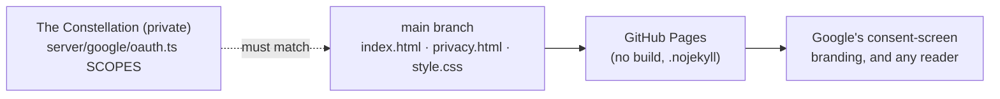

# constellation-app-info

The public homepage and privacy policy for the Google sign-in of
[The Constellation](https://github.com/AlexRosen23/constellation), a personal 3D command center that runs only on its
owner's Mac. Google won't publish an OAuth app's consent screen without a public homepage and a public privacy
policy, and The Constellation's own repository is private, so these two pages live here. They are for Google and for
anyone who wants to know exactly what the app does with a connected Google account.

- **Homepage:** https://alexrosen23.github.io/constellation-app-info/
- **Privacy policy:** https://alexrosen23.github.io/constellation-app-info/privacy.html

## At a glance

| | |
|---|---|
| **Status** | Working: both pages are live on GitHub Pages. The Google integration they describe is built but not connected yet. |
| **Stack** | Plain HTML and CSS: no build step, no scripts, no trackers, no external assets |
| **Run it** | open `index.html` in a browser |
| **Verified** | 2026-11-09 against `main` at `e7c24e5`, and the scopes against The Constellation's `main` at `a991626a` ([how](#what-works-today)) |

## Why this exists

### The problem

The Constellation can show its owner's Gmail (read only) and Google Calendar, and add or change a calendar event after
a preview and a confirmation. It signs in with the owner's own Google Cloud project. While that project's consent
screen is in Google's **Testing** status, the sign-in expires 7 days after it is granted, so the owner would have to
reconnect every week. Publishing the consent screen to **In production** fixes that, and Google refuses to publish
until the app has a homepage URL and a privacy-policy URL (step A7 of The Constellation's `docs/CONNECT-GOOGLE.md`).
The app is for one person, so the setup guide does not submit it for Google's verification, which matters only for
apps with more than 100 users. The policy still has to say precisely what is read, what is kept and what is never
done, because Gmail read access is personal data and the owner should be able to hold the code to it.

### Why the obvious approaches fall short

| obvious approach | why it isn't enough here |
|---|---|
| Put the pages in The Constellation's repository | That repository is private, and GitHub Pages isn't available for private repositories on the owner's free plan. |
| A generic privacy-policy template | A template promises nothing specific. Google and the owner need the exact scopes and the exact handling, so that the policy can be checked against the code. |
| Host the pages on a personal domain | It adds a domain, DNS and hosting to maintain, for two static pages. |

### Principles that follow

- **The policy is a contract with the code.** It lists exactly the scopes The Constellation requests: `openid`,
  `email`, `gmail.readonly`, `calendar.events` and `calendar.calendarlist.readonly`, the same list as `SCOPES` in the
  private repository's `server/google/oauth.ts`. The same file refuses any send, modify, compose or full-calendar
  scope, so "never sends, drafts, deletes or changes email" is enforced in code, not only promised here.
- **Update the policy first.** Before The Constellation uses any new Google data, `privacy.html` changes here, in public
  history.
- **Nothing to trust on the page itself.** No JavaScript, no analytics, no fonts or images from other servers. The
  pages can't collect anything from the people who read them.

## What works today

| capability | status | how it was verified |
|---|---|---|
| Homepage and privacy policy served by GitHub Pages from `main` | Working | both URLs returned HTTP 200 on 2026-11-09; the last Pages build (2026-11-07) succeeded |
| Scopes listed in the policy match the code | Working | compared on 2026-11-09 with `SCOPES` and `FORBIDDEN_SCOPES` in The Constellation's `server/google/oauth.ts` (`main` at `a991626a`) |
| "Email content is never passed to the AI assistants" | Matches the code | The Constellation's voice assistant's brain is never given mail or calendar (`NOT_GIVEN` in `server/jarvis/brain.ts`); calendar and mail questions are answered locally |
| Light and dark themes | Working | `prefers-color-scheme` in `style.css` |
| The Google connection itself (in The Constellation) | Built, not connected | The Constellation's features list (§6.2) records Gmail and Calendar as "built, not connected". Whether the consent screen has been published isn't recorded in either repository |

## Quick start

Open `index.html` in a browser. There is nothing to install or build. To preview it over HTTP, as GitHub Pages serves
it (checked 2026-11-09: both pages and the stylesheet return 200):

```bash
python3 -m http.server 8000 --bind 127.0.0.1   # then open http://127.0.0.1:8000/
```

## How it works



- `index.html` says what the app is, the three things it can do with a connected Google account, and where it runs
  (only on the owner's Mac, on its loopback address, with credentials in the macOS Keychain).
- `privacy.html` lists each scope and why it is needed, how the data is handled (read live, not stored; one temporary
  audio file for a spoken calendar answer, deleted once played; never shared, sold, used for ads or used to train
  models), the Google API Services User Data Policy statement, and how to remove access.
- `.nojekyll` tells GitHub Pages to serve the files as they are.

## How it was built

| date | what landed | where |
|---|---|---|
| 2026-10-21 | both pages, written the same day as The Constellation's Gmail and Calendar connection (its PR #50, merged 2026-10-21) and its setup guide's Branding step | initial commit `e4bbeed` |
| 2026-11-07 | README rewritten with an overview and build stats | [PR #1](https://github.com/AlexRosen23/constellation-app-info/pull/1) |
| 2026-11-09 | this write-up | PR `docs/readme-writeup` |

The pages and the policy were written by Claude Code under the owner's direction and review, from the code of the
Google integration rather than from a template.

## Limitations and what's next

- **Not connected yet.** The Constellation's Gmail and Calendar features are "built, not connected" until the owner
  completes the Google Cloud setup in its `docs/CONNECT-GOOGLE.md` and runs `npm run google:connect`.
- **Keeping the policy true is a manual step.** Nothing automatically compares the scopes listed here with the code.
  A check in The Constellation's test suite that reads this page would close that gap.
- **No license file.** The repository is public so that Pages can serve it; that doesn't grant reuse rights.

## Repository map

| path | what lives there |
|---|---|
| `index.html` | the homepage |
| `privacy.html` | the privacy policy |
| `style.css` | shared styles, light and dark |
| `.nojekyll` | serve the files as they are |
| `.githooks/`, `.gitleaks.toml` | gitleaks before every commit and push; direct pushes to `main` are refused |

## Testing and CI

There are no tests: the pages have no code. Checks for this write-up were manual (HTTP status of both URLs, the scope
list compared with the code). GitHub Actions runs only GitHub's own "pages build and deployment" workflow when `main`
changes; the repository has no workflow files of its own.

## Related

- [The Constellation](https://github.com/AlexRosen23/constellation) (private repository): the app these pages describe
- [Google API Services User Data Policy](https://developers.google.com/terms/api-services-user-data-policy)
- Questions or concerns: open an issue in this repository
